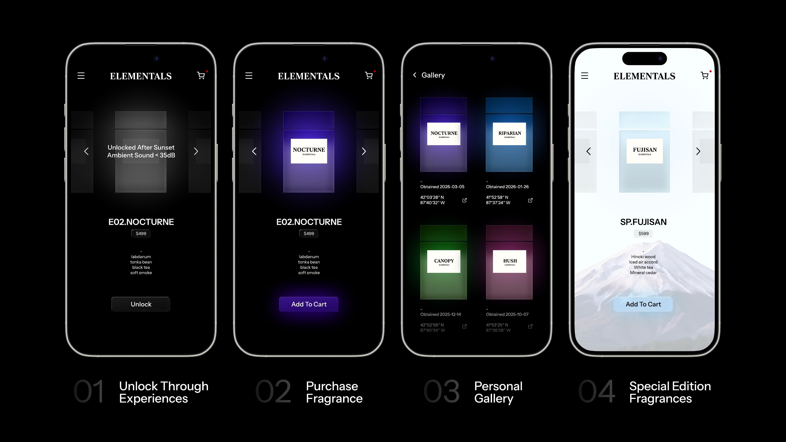

# Elementals

## Message

> Luxury can be defined by experience rather than price: scents unlocked by real places, using only the sensors already in a phone.

**Statement (under hero):**
Elementals turns fragrance from something you buy into a memory you discover: each scent is earned through an experience in nature, then kept as a personal archive.

**Summary block (top of page, 2026-11-18):**
- **Problem:** Luxury fragrance is premium in price but generic in experience: smell a few blotter strips, buy a bottle.
- **Solution:** A mobile service where each scent unlocks only in a real place and moment, checked by the phone's GPS, clock, and microphone.
- **Outcome:** A full service concept and app UI for L'Oréal Brandstorm 2026, built in a market new to our team.
- Then: Role · Team · Timeline · Domain (Luxury · Beauty) · Methods (Market research, Service design, UI/UX design) · Tools

Page structure follows myPOMO: Summary → Problem → Insight → Design Response → Why It Works → Outcome & Reflection (What I Learned).

## Headings only

1. Premium in Price, Generic in Experience
2. Luxury Defined by Experience, Not Price
3. Discover, Unlock, Collect
4. Built With What's Already in Your Pocket
5. Moving Fast in Unfamiliar Territory

---

## Premium in Price, Generic in Experience

*Problem*

Luxury fragrance shopping has barely changed in decades: walk into a store, smell a few blotter strips, buy a bottle. In a market crowded with similar launches, another bottle doesn't create new emotional value.

## Luxury Defined by Experience, Not Price

*Insight*

We were new to the European fragrance market, so we started with market research on luxury perfume: its price range, what goes into it, what makes it feel luxurious, and who it is for. The gap we found: nothing ties a scent to the places and moments it is meant to evoke. For younger consumers, a fragrance linked to a real memory is worth more than a higher price tag.

**Evidence:** desk market research (price, ingredients, sources of luxury, target customers)

## Discover, Unlock, Collect

*Service design*

The whole journey runs on a mobile phone. Its standard sensors (GPS, time, and sound) check when real-world conditions are met.

1. **Unlock.** Each scent opens only under set conditions. Nocturne unlocks after sunset, when ambient sound is under 35 dB.
2. **Purchase.** Once unlocked, the scent can be bought right in the app.
3. **Gallery.** Every unlock is saved with the date and coordinates where it happened.
4. **Special editions.** Rare scents unlock only at unique sites, like Fujisan at Mt. Fuji.

[TODO: Since your role was UI/UX: one or two screen-level design decisions, e.g. how the locked state communicates the unlock condition.]

**Evidence:** design (service flow + UI)

## Built With What's Already in Your Pocket

*Why it works*

- **Feasible.** Unlocking uses standard phone features, with no extra hardware. The scents themselves are developed and produced the usual way.
- **Sustainable.** Refillable bottles cut packaging waste. One standard glass bottle serves every scent; only the label and color change.
- **Inclusive.** Value comes from experiences open to anyone, not from price alone. Every scent is gender-, race-, and identity-neutral.
- **Scalable.** Partnerships with national parks, tourism boards, and conservation groups create location-specific editions. These partnerships encourage travel and exploration.
- **Measurable.** Success is tracked by the Unlock-to-Purchase Conversion Rate: the share of users who buy within a set time after an unlock.

## Moving Fast in Unfamiliar Territory

*Outcome & reflection*

In a short time, we learned an unfamiliar market, spotted a meaningful gap, and turned it into a clear, realistic concept. It also pushed us into new ground: how technology and interaction can support a more personal kind of luxury.

---

## Notes (not for the page)

**What changed from the current HTML**
- "Why It Works" now leads with **Feasible**, which ties back to the message (only phone sensors), and has a claim heading instead of a list of five virtues. Consider cutting it to the 2–3 points that matter most. Five reads like a competition rubric.
- Added TODOs where the page asserts things without showing them: the research behind the insight, and Josuke's own UI decisions.

**To confirm**
- Competition result: did not pass the preliminary round. Not shown on the page (decided 2026-11-18).
- [TODO: Which screens/decisions were Josuke's?]
