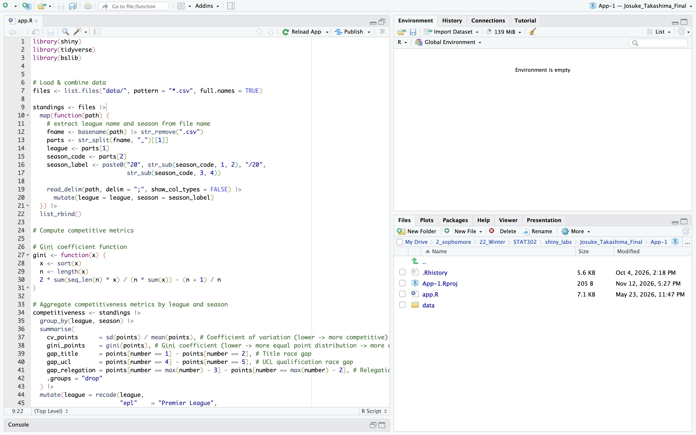
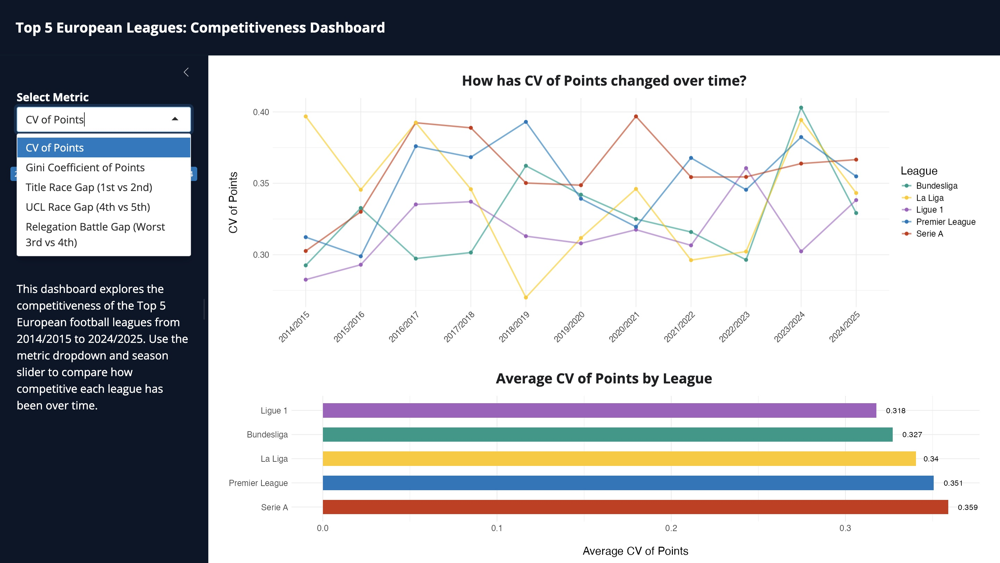
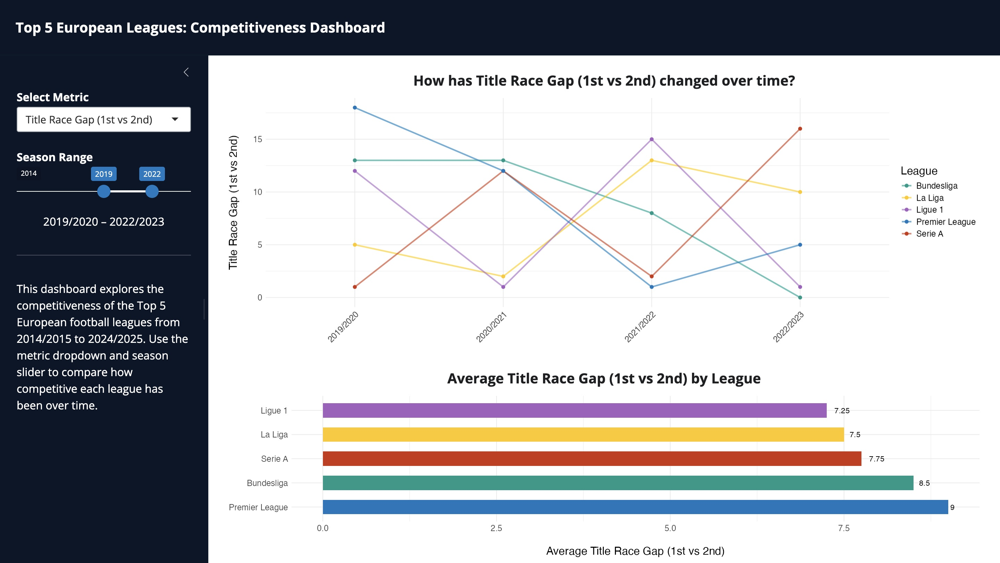

# European Football Competitiveness

## Message

> Competitiveness isn't one number. Five measures read side by side reveal patterns, like La Liga's two tiers, that any single measure hides.

**Statement (under hero):**
Who wins the league says little about how competitive it is. This dashboard splits competitiveness into five measures, from the spread of the whole table to the title race, the Champions League places, and the relegation fight, so leagues can be compared on more than one number.

## Headings only

1. "Most Competitive" Is Usually a Claim, Not a Measurement
2. Five Measures, Two Views of the Table
3. One Question per Chart
4. Competitive at the Top Doesn't Mean Competitive Everywhere
5. La Liga's Two Tiers
6. [TODO: Reflection headline]

---

## "Most Competitive" Is Usually a Claim, Not a Measurement

*Problem*

Arguments about which league is most competitive tend to rest on a single storyline, such as a close title race or a surprise champion. But a league has several contests running at once, at the top, in the middle, and at the bottom. One number, or one season, can hide where the real competition is.

## Five Measures, Two Views of the Table

*Approach*

I combined final standings for the Premier League, La Liga, Bundesliga, Serie A, and Ligue 1 across eleven seasons (2014/15 to 2024/25). From them I calculated two measures of how evenly points are spread across the whole table, and three gaps at the positions where the stakes are highest. For every measure, lower means more competitive.

**Whole table**
- **CV of points.** Standard deviation of points divided by the mean: how spread out the table is, comparable across leagues.
- **Gini coefficient of points.** How unequally points are distributed, borrowed from the way economists measure income inequality.

**Where the stakes are**
- **Title race gap.** Points between 1st and 2nd.
- **UCL race gap.** Points between 4th and 5th: the race for the last Champions League place.
- **Relegation battle gap.** Points between the last safe team and the first team in the relegation zone.

*One CSV per league and season is combined into a single table, then each measure is computed per league and season.*

**Evidence:** quantitative (standings data)

## One Question per Chart

*Design*

The dashboard has two controls, and both charts update together. The metric dropdown exists because no single measure captures competitiveness, and different readers care about different parts of the table. The season slider supports questions like "which league was most competitive in the last five years?" as well as "over all eleven?", which matters because several trends shift partway through the period.

1. **Trend.** The line chart is titled as a question ("How has this changed over time?") so the reader knows what to look for.
2. **Summary.** The bar chart averages each league over the selected seasons, sorted so the most competitive league sits at the top.
3. **Consistent color.** Each league keeps the same color in both charts, so the trend and the average can be read together.
4. **Adjustable window.** The slider narrows the range, and the averages are recalculated for that period only.

*Switching between the five measures.*

*Title race gap, narrowed to 2019/20 – 2022/23.*

**Evidence:** design (interaction decisions, each tied to a reader's question)

## Competitive at the Top Doesn't Mean Competitive Everywhere

*Findings*

- **Two measures, one ranking.** CV and Gini rank the leagues almost identically, which suggests they capture the same underlying dimension of competitiveness.
- **Shifting title races.** In the first half of the period, La Liga had a notably small title gap. Over the last five seasons, the Premier League has had the smallest, as its title race has become more contested.
- **A fixed group at the Champions League line.** La Liga and Ligue 1 have historically had larger gaps between 4th and 5th. Champions League places tend to go to the same group of top clubs rather than being openly contested.
- **The Premier League's lopsided bottom.** The Premier League's relegation gap is far larger than in any other league. Its relegation battles are less tightly contested than they are commonly thought to be.

## La Liga's Two Tiers

*Reading the measures together*

No single measure explains La Liga, but together they do. A small title gap, a consistently large gap at the Champions League line, and an overall spread of points that is not extreme point to a two-tier league. The top clubs compete closely among themselves, and the rest of the table is evenly matched below them. The relegation gap supports this: it has stayed small in every season except 2017/18, so the lower half is tightly contested too.

This is why the dashboard offers five measures rather than one. The pattern only appears when they are read side by side.

> **Image placeholder:** La Liga across the measures (title gap vs. UCL gap vs. relegation gap), so the two tiers can be seen, not just read.

## [TODO: Reflection headline]

*Reflection*

[TODO: Reflection copy. Possible angles, pick what's true for you: what you'd measure next; what surprised you; who would use this (fans, journalists, league officials?) and what they'd need.]

---

## Notes (not for the page)

**What changed from the current HTML**
- Nothing structural. This page already follows its argument. The five measures are split into "whole table" and "where the stakes are" so the "two views" in the heading are visible.
- Added an image placeholder for La Liga, since that's the page's payoff and it has no visual yet.

**To confirm**
- [TODO: Reflection headline and copy]
- [TODO: Who is the reader? Naming one, even just "fans arguing about leagues", would bring a people side to a data-only page.]
