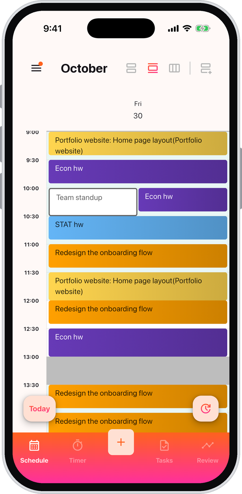
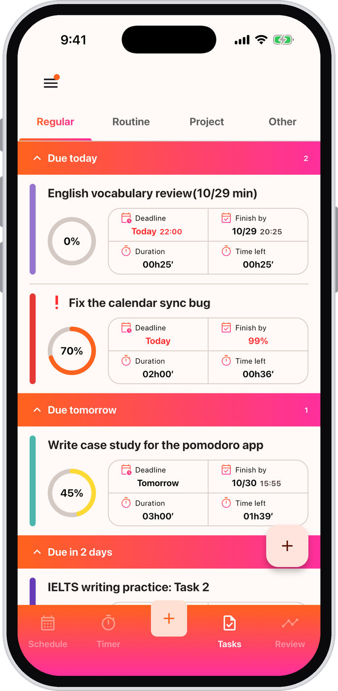
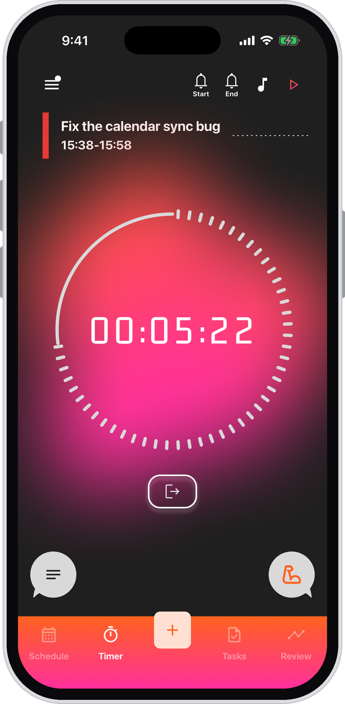
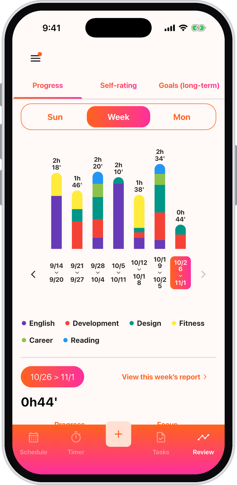

# myPOMO

## Message

> Survey data showed people don't lack time; they stall at planning. So myPOMO plans for them, and each version was redesigned from what users said.

**Statement (under hero):**
Built from 817 survey responses and 57 pieces of beta feedback, myPOMO plans your day so you can spend it working, not planning.

**Summary block (top of page):**
- **Problem:** People have free time but can't turn it into work. 85% of those we surveyed said so.
- **Solution:** An app that builds your schedule from your free time, deadlines, how long each task will take, and its priority, then guides each focus session.
- **Outcome:** Two national awards. 57 pieces of beta feedback are now shaping the app.
- Then: Role · Team · Timeline · Domain · Methods (tags) · Tools

## Structure (2026-11-18, based on DSGN 370 guest panel: problem and outcome first, then evidence, then process)

0. Hero
1. Summary block
2. It's Not a Lack of Time. It's Not Using It. (problem + "Where Time Slips Away" + "Who We Asked")
3. Planning Is the Burden
4. Take the Planning Off Their Hands
5. Ask, Build, Listen, Redesign
6. Recognized Nationally. Now Proving It Works. (awards, what I learned, next)

---

## It's Not a Lack of Time. It's Not Using It.

*Problem*

In our pre-beta survey, most people said they have free time but can't turn it into work.

- **85%** can't make good use of their free time
- **39%** say they have no free time at all

Note: Pre-beta survey, first analysis n = 584 (working adults n = 132, Nov 2025). Total responses now 817.

**Evidence:** quantitative (survey)

## Where Time Slips Away

*Pain points*

- **Procrastination: 88%.** Most put tasks off until the deadline. 42 people named it their single biggest problem.
- **Plans that don't hold: 85%.** Even after making a plan, people can't follow it.
- **Planning itself: 63%.** Many can't make a plan in the first place.

**Evidence:** quantitative (survey), with open answers ("biggest problem")

### Who We Asked

Occupation of 751 respondents (shown as a stacked bar):

| Group | n | % |
|---|---|---|
| Students | 491 | 65.4% |
| Working adults | 195 | 26.0% |
| Homemakers | 40 | 5.3% |
| Other (rōnin students 5, part-time workers 3, unemployed 2, vocational trainees 2, individual answers 13) | 25 | 3.3% |

Note: 76 respondents left this blank, mainly because they chose "someone else (a child, a student)" for who they'd use myPOMO for, and the form's branching skipped the question.

## Planning Is the Burden

*Insight*

People don't fail for lack of time or motivation. They stall at deciding what to do and when.

**Diagram (built in HTML/CSS):** one illustrative day. 01 free time between classes → 02 tasks with estimated time, deadline, and priority (Reading 1 h · due Thu · high, Report 1.5 h · due Fri · medium, Exam prep 1.5 h · due Mon · low) → "myPOMO fits the tasks into your free time" → 03 the free time filled with short focus sessions. Caption: "Illustrative example of one day. You enter only 01 and 02; myPOMO decides when to do what."

## Take the Planning Off Their Hands

*Design response*

myPOMO takes that decision away from the user. It builds the schedule automatically from your free time, deadlines, how long each task will take, and its priority, using the Pomodoro Technique. The app is one loop: plan, focus, reflect.

| Plan | Focus | Reflect |
|---|---|---|
| **Schedules that build themselves.** Enter each task once, with its deadline, estimated time, and priority. myPOMO fits them into your free time and reschedules when plans change. | **A timer that keeps you in focus.** Pomodoro sessions with clear starts and breaks, showing what comes next so there is nothing to decide. | **Reports that close the loop.** Daily and weekly reports show what you achieved, and a short review sets up tomorrow. |
|   |  |  |

**Evidence:** design (screens). Each feature answers one pain point: planning itself → Plan, procrastination → Focus, plans that don't hold → Reflect.

## Ask, Build, Listen, Redesign

*Process*

Each version started from what users told us. A sign-up survey found the problem, a beta tested the core idea, and beta feedback keeps reshaping the app.

| 01 Pre-beta survey | 02 Beta release | 03 Feedback | 04 Redesign |
|---|---|---|---|
| **817** responses to the beta sign-up survey, on where people struggle | **β** tested auto-scheduling + focus timer | **57** requests and bug reports from users | **↻** improving the app from that feedback, ongoing |

### From feedback to design

All three responses are implemented (confirmed 2026-11-18).

| What users said | What we built |
|---|---|
| "We rarely follow the plan exactly. Let us adjust it by tapping." | Drag-and-drop editing of the generated schedule, so the plan stays a guide, not a rule. |
| Setting free time day by day is a hassle. (paraphrase) | Google Calendar import: existing events come into myPOMO and are taken out of free time automatically. |
| Work "starts and ends without a clear edge." | Check-in and check-out moments that frame each focus session. |

**Evidence:** qualitative (beta feedback) next to quantitative (survey). This is the page's design ↔ data loop.

## Recognized Nationally. Now Proving It Works.

*Outcome & next*

- **Awards.** National Grand Prix, National PC Olympiad 2022, and 3rd Place, Teen Apps Awards 2023. Both are national app development contests for high school students.
- **What I learned.** An app has to do two things at once: offer the features people need, and stay intuitive enough to use in as few steps as possible. Holding both together matters as much as either one.
- **Next.** After launch, a follow-up survey will test the core claim: do users start tasks earlier and use more of their free time?

---

## Notes (not for the page)

**What changed from the current HTML**
- The three separate feature sections are merged into one "plan → focus → reflect" section, placed right after the insight. The page now reads problem → insight → response instead of ending as a product tour.
- The Problem lead no longer says "of working adults". The survey note keeps the breakdown.

**To confirm**
- [TODO: Strong user quotes (survey open answers or beta feedback) for the Problem section]
