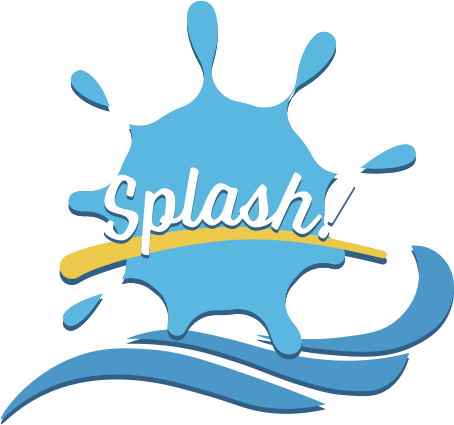
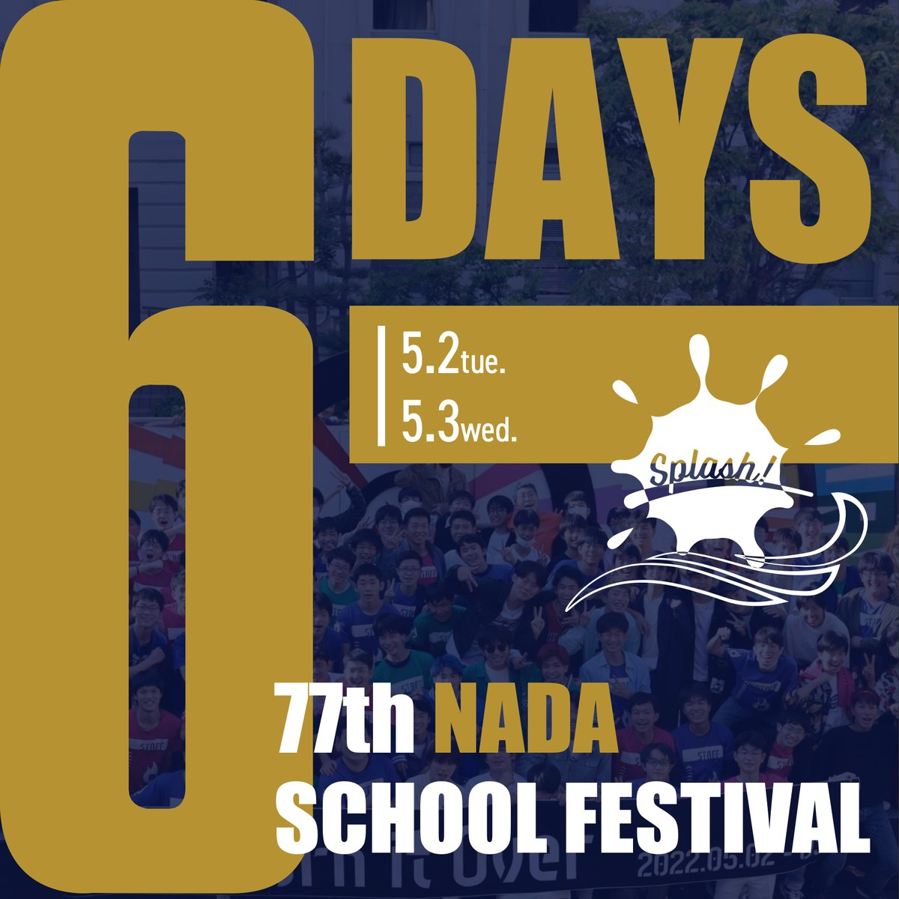
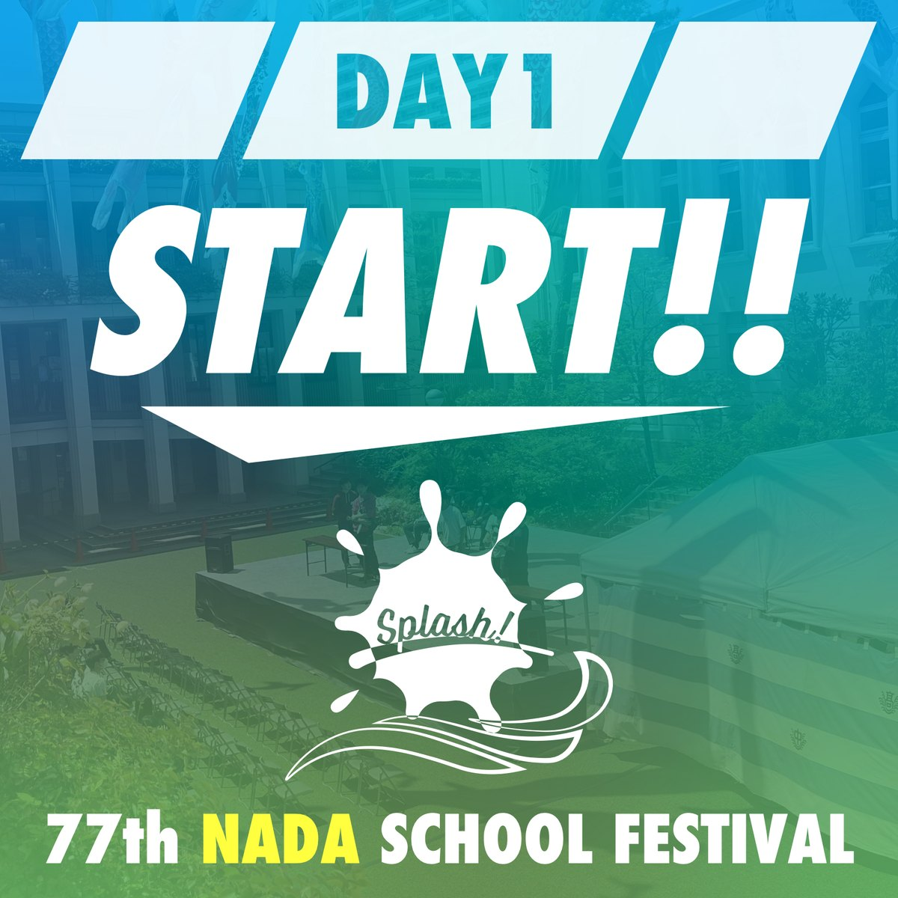

# 77th NADA School Festival

## Message

> Reopening the festival to everyone meant its identity had to work for two audiences at once, so I built it from one logo and tested it with both until it did.

**Statement (under hero):**
"Splash!" was the theme and visual identity of the 77th NADA School Festival, the first held without attendance limits since the pandemic. I led the design team, building everything from the logo outward. Over two days, the festival drew a record 30,000+ visitors.

**Summary block (top of page, 2026-11-18):**
- **Problem:** The festival was reopening to everyone after the pandemic. Its identity had to win over both the students running it and visitors from outside.
- **Solution:** One logo, "Splash!", revised with both audiences for over two months, then carried through every touchpoint.
- **Outcome:** A record 30,000+ visitors over two days, the most in the festival's history.
- Then: Role · Team · Timeline (2023) · Domain (Education · Events) · Methods (Concept workshop, Feedback rounds (students + visitors), Logo design, Visual identity) · Tools

Page structure follows myPOMO: Summary → Context → Brief → Design Response → Process (+ applications as a sub-section) → Outcome (Result / What I Learned [TODO]).

## Headings only

1. A Festival Reopening to Everyone
2. Designing for Two Audiences
3. Two Meanings in One Word
4. Two Months of Asking Both Sides
5. One Identity Across Every Touchpoint
6. A Record 30,000+ Visitors in Two Days

---

## A Festival Reopening to Everyone

*Context*

Since the pandemic, the festival had been held with limits on who could attend. As student government president, I negotiated with the principal to open it to everyone again.

That raised the stakes for its design: the festival needed an identity the students running it could believe in, and one that would draw in visitors from outside.

**Evidence:** working with the school as an institution, before any design started

## Designing for Two Audiences

*The brief*

The design team produced the merchandise, posters, pamphlet, website, and social media banners. All of them grew from one logo, so I focused there first, and I held it to two conditions:

- **The students own it.** The students building the festival accept the meaning behind the logo, so the logo itself becomes their vision.
- **Visitors are drawn to it.** People from outside the school find it visually appealing.

## Two Meanings in One Word

*Concept*

The theme and the logo's concept were set together, at the leadership meeting that chose the theme. There, I drew out what the committee members wanted this festival to be, and that became the concept.

- **A splash of water.** Energy bursting out all at once.
- **A mix of colors.** In Japanese, the theme also carries the sense of *madara*, mottled or mixed. The sweat and feelings of students and visitors mix together and burst out at once, painting a festival unlike any other.

**Evidence:** qualitative (drawing out the committee's goals)

## Two Months of Asking Both Sides

*Process*

I gathered opinions from students and from people outside the school again and again, revising after each round, until the logo met both conditions. It took more than two months to finish.

> **Image placeholder:** Logo iterations, showing what changed after feedback rounds

**Evidence:** qualitative (repeated feedback from both audiences)

## One Identity Across Every Touchpoint

*Applications*

The logo carried through to merchandise, posters, the pamphlet, the website, and a series of social media banners, including a countdown to the festival and a banner for each day.

## A Record 30,000+ Visitors in Two Days

*Outcome*

Over its two days, the festival drew more than 30,000 visitors, the most in its history. [TODO: What shows the banners' role? e.g. follower growth, post reach, how visitors heard about it.]

---

## Notes (not for the page)

**What changed from the current HTML**
- "Designing for Two Audiences" moved up to right after Context. It's the brief that the rest of the page answers, so the page now reads: why it mattered → what the logo had to do → concept → how it was tested → where it went → result.
- The "two months of feedback" process got its own heading, so the iteration shows up in the headings test.
- Removed "Publicity through the social media banners worked well" from the outcome until there's something to back it up. A record turnout also reflects the reopening itself.

**To confirm**
- [TODO: Anything that shows the banners' effect (follower growth, reach, survey of visitors)?]
- [TODO: Are logo iteration images available?]
- [TODO: Year: page says 2023. Confirm.]
